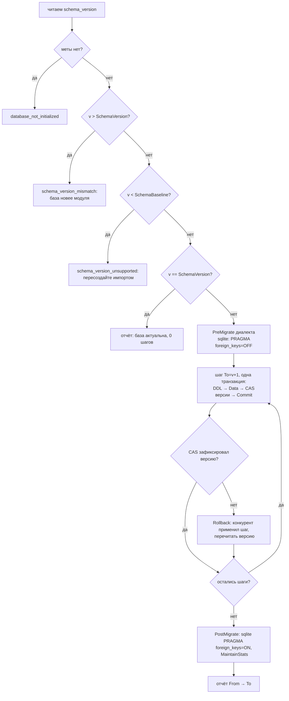

# 09. Миграции схемы базы данных (только вперёд от базовой версии)

Статус: проектный документ. Вводит механизм миграций, заменяющий решение D5
(«без миграций») формулировкой **«миграции только вперёд от базовой версии»**;
правка решений и связанных мест плана — по перечню §10. Связанные документы:
`02-database.md` §5 (версия схемы, сидирование), `01-architecture.md` §2.1
(контракты ошибок), `04-module-functionality.md` §3 (CLI), `05-work-plan.md`
(риск R4).

## 1. Постановка и принципы

Опыт версий 8–15 показал цену D5: каждое изменение схемы требовало
пересоздания базы повторным импортом с редактированием файлов наполнения.
Механизм миграций вводится со следующими принципами:

- **Только вперёд (forward-only).** Шаги миграции переводят базу с версии N
  на N+1; откатов (down-миграций) нет. Страховка — внешняя: копия файла
  sqlite / `pg_dump` до миграции (рекомендация в справке CLI).
- **Один шаг — один инкремент версии — одна транзакция.** Свод правил на
  каждую версию схемы; шаг либо применяется целиком, либо база остаётся на
  прежней версии. Падение на середине цепочки оставляет базу на последней
  зафиксированной версии — повторный запуск продолжает с неё.
- **Двойственность создания схемы.** Свежая база создаётся целиком
  `EnsureCreated` (полный DDL, сразу `SchemaVersion`); миграции — только для
  существующих баз. Корректность двойственности закреплена инвариантом
  эквивалентности (§9).
- **Миграция — явное действие.** Автомиграций при чтении нет; точки входа —
  CLI `catalogctl migrate`, Go API `App.Migrate` (service/components),
  опция `Config.Migrate` для встраивания (§8). Команды записи (`init`,
  `import`, `add`) на базе прежней версии по-прежнему отказываются —
  совет в ошибке меняется на «выполните migrate».
- **`schema_meta.schema_version` — единственный источник истины.** Таблица-
  журнал применённых миграций не заводится: строго последовательные шаги и
  единый счётчик версии делают журнал избыточным.
- **Старые версии забываются.** Ни DDL, ни шагов для версий ниже базовой в
  коде нет; путь для них — пересоздание импортом (как при D5).

Сценарии открытия базы:

| Состояние базы | Поведение |
|----------------|-----------|
| нет таблицы `schema_meta` | `database_not_initialized` (без изменений) |
| `v == SchemaVersion` | штатная работа; `migrate` сообщает «база актуальна» |
| `SchemaBaseline <= v < SchemaVersion` | `migrate` применяет шаги `v+1 … SchemaVersion` |
| `v < SchemaBaseline` | `schema_version_unsupported` — пересоздание импортом |
| `v > SchemaVersion` | `schema_version_mismatch` — база новее модуля, обновить модуль |

## 2. Термины

- **Версия схемы базы** — значение `schema_meta.schema_version`.
- **`SchemaVersion`** — константа модуля (`internal/storage/ddl.go`),
  инкрементируется при любом изменении DDL или состава хранимых данных
  записи (без изменений).
- **`SchemaBaseline`** — минимальная поддерживаемая версия схемы
  (`internal/storage`), вводится этим документом и равна **15** (первая
  версия с механизмом миграций).
- **Шаг миграции** — правила перехода с версии `To−1` на `To`: запись
  реестра `migrations`.
- **План миграции** — перечень неприменённых шагов (для `--dry-run` и
  отчётов); функция от текущей версии базы и реестра.

## 3. Реестр шагов

Реестр живёт в `internal/storage/migrate.go` рядом с DDL:

```go
// Migration — правила перехода с версии To-1 на To: одна запись реестра,
// одна транзакция применения. DDL — переносимый текст (переписывается
// RewriteDDL диалекта, как ddlStatements); Data — опциональная доработка
// данных и диалектозависимые операции (ветвление по диалекту — только
// здесь, внутри storage).
type Migration struct {
    To   int
    Desc string // краткое описание шага: dry-run, отчёты, журнал
    DDL  []string
    Data func(ctx context.Context, tx *Tx) error
}

var migrations = []Migration{} // пуст, пока SchemaVersion == SchemaBaseline
```

Правила реестра:

- **RB-1.** Каждый инкремент `SchemaVersion` выше `SchemaBaseline`
  обязан сопровождаться шагом с `To == SchemaVersion`. Изменение
  `ddlStatements` без шага невозможно: пин-тест требует непрерывную цепочку
  `SchemaBaseline+1 … SchemaVersion`; пустой реестр валиден только при
  `SchemaVersion == SchemaBaseline`.
- **RB-2.** Версии шагов строго последовательны и монотонны; дубликаты и
  пропуски — ошибка пин-теста.
- **RB-3.** `DDL` шага — только переносимые операторы (§5); всё
  диалектозависимое — в `Data`-хуке или хуках диалекта (§5).
- **RB-4.** Шаг не пишет события `change_events`; ревизии — по правилу §6.
- **RB-5.** Содержимое шага неизменяемо после релиза, его включившего:
  правка шага = правка истории = несовместимое изменение. Исправление
  ошибочного шага — новым шагом.

Образец шага (гипотетический, версия 16):

```go
{To: 16, Desc: "device_notes: колонка source_revision",
    DDL: []string{
        `ALTER TABLE device_notes ADD COLUMN source_revision INTEGER NULL`,
    },
    Data: func(ctx context.Context, tx *Tx) error {
        _, err := tx.exec(ctx, `UPDATE device_notes SET source_revision = @rev`,
            map[string]any{"rev": 0})
        return err
    }},
```

## 4. Алгоритм применения



Семантика по шагам:

1. **Чтение версии.** Отсутствие меты — `database_not_initialized`.
   Нечисловая версия — как в `CheckSchema` (повреждённая база).
2. **Верхние и нижние отказы** — до любых записей (база не мутируется):
   по таблице §1.
3. **Хуки диалекта.** `PreMigrate`/`PostMigrate` выполняются на выделенном
   соединении записи **вне транзакций** (sqlite: `PRAGMA foreign_keys` —
   no-op внутри транзакции; postgres: нет операций). `PostMigrate`
   завершается обслуживанием статистики по образцу массовой записи
   (`MaintainStats` — ANALYZE/PRAGMA, данных не меняет).
4. **Шаг — одна транзакция** (`Begin` → DDL → `Data` → CAS → `Commit`):
   - операторы `DDL` проходят `RewriteDDL` и выполняются с ретраем
     «already exists» (гонка параллельного писателя postgres — как в
     `EnsureCreated`);
   - `Data` — доработка данных/структуры переносимым DML;
   - **CAS-фиксация версии** — защита от параллельного `migrate` без
     глобальных блокировок:

     ```sql
     UPDATE schema_meta SET value = @to
     WHERE key = 'schema_version' AND value = @from
     ```

     `RowsAffected = 0` — конкурент зафиксировал этот шаг раньше: откат
     всей транзакции шага (включая его бэкфилл), перечитывание версии,
     продолжение с актуального места. `RowsAffected = 1` — Commit.
5. **Сбой шага** — `schema_migration_failed` (from, to, деталь); база
   остаётся на последней зафиксированной версии, повторный `migrate`
   продолжит цепочку. Частично применённый шаг исключён транзакцией.
6. **Журнал** — по строке на шаг в `slog` (info): версия, `Desc`.
7. **`--dry-run`** — план без открытия транзакций: текущая версия и список
   шагов с `To > v` (для CLI и отчётов).

Идемпотентность на уровне механизма: повторный запуск на актуальной базе —
отчёт «база актуальна», ни одной транзакции записи.

## 5. Переносимость шагов

Граница — как у DML ядра (AGENTS.md): переносимое ядро + диалекты только
в `Dialect`/`Data`-хуках внутри `internal/storage`.

Разрешено в `DDL` шага:

| Оператор | Примечание |
|----------|-----------|
| `CREATE TABLE IF NOT EXISTS …` | с токеном `{{AUTOINC}}`; типы INTEGER/REAL/TEXT; булевы — INTEGER 0/1; «не задано» — NULL |
| `CREATE INDEX IF NOT EXISTS …` | по образцу `ddlStatements` |
| `ALTER TABLE … ADD COLUMN … NULL` | без константных DEFAULT; значение — бэкфиллом в `Data` (переносимо в обоих диалектах) |
| `DROP INDEX IF EXISTS …` | переносим |

Всё прочее — только в `Data`-хуке Go-функцией:

- **Пересоздание таблицы** (смена PK/типа колонки, как в v11): паттерн
  «create new (через `RewriteDDL`) → `INSERT INTO new SELECT …` → `DROP old`
  → `RENAME`». Подводные камни по диалектам: DROP родителя при включённых
  FK в sqlite невозможен — поэтому хуки `PreMigrate`/`PostMigrate` отключают
  FK-прагму на время миграции; postgres FK следуют за RENAME.
- **Бэкфиллы** — переносимый DML: `@имя`-плейсхолдеры через `tx.exec`,
  чанкование `maxInList`, вставки строк — `InsertIfAbsent`/`InsertIfAbsentReturningID`
  (параллельные писатели postgres не получают ошибок уникальности).
- Запрещены: JSON-функции СУБД, диалектные типы, хранимые процедуры,
  неявные зависимости от порядка шага (шаг читает только состояние версии
  `To−1`, которое гарантирует цепочка).

## 6. Ревизии, кэш и change_events

Миграция — операция схемы, ревизии по умолчанию не инкрементирует.
Исключение — правило для `Data`-хуков:

- шаг, меняющий строки, читаемые снимком каталога (таблицы каталога), —
  однократный `BumpCatalogRevision` в конце хука;
- шаг, меняющий карточные данные устройств, — однократный
  `BumpDataRevision`.

Иначе кэш `catalog.Cache` и ETag REST не заметят изменения (быстрая
проверка — по ревизии). События `change_events` миграция не пишет: это
фид записей устройств, а не схемы; инкремент `data_revision` без событий
допустим (образец — реестр производителей и источников).

## 7. Ошибки и сообщения

По общим правилам: код — константа `domain.Code…`, MsgID — константа
`domain.Msg…`, форматы en/ru — бандлы `internal/i18n` одним изменением;
полнота — тестом `messages_test.go`. Тексты ниже — дословные контракты.

| Код / MsgID | en (канонический) | ru |
|-------------|-------------------|----|
| `schema_version_unsupported` (новый) | database schema version {db} is below the minimum supported {baseline}; recreate the database: delete the database and import fill files with the current module | версия схемы базы ({db}) ниже минимально поддерживаемой ({baseline}); пересоздайте базу: удалите файл/базу и выполните import актуальным модулем |
| `schema_migration_failed` (новый) | schema migration step {from} → {to} failed: {detail}; the database remains at version {from}; fix the cause and run migrate again | шаг миграции схемы {from} → {to} не выполнен: {detail}; база осталась на версии {from}; устраните причину и повторите migrate |
| `schema_version_mismatch` (текст меняется) | database schema version {db} does not match module version {module}; if the database is older, run migrate; if newer, update the module | версия схемы базы ({db}) не совпадает с версией модуля ({module}); если база старее — выполните migrate, если новее — обновите модуль |

Изменение текста `schema_version_mismatch` — несовместимое изменение
формата сообщения (аргументы и код не меняются); фиксируется в CHANGELOG.

Строки CLI (`domain.Msg…` + бандлы): `cli_use_migrate` (строка
использования), `cli_migrate_done` («мигрировано: {from} → {to}, шагов:
{n}» / «migrated: {from} → {to}, steps: {n}»), `cli_migrate_uptodate`
(«база уже на версии {v}» / «database is already at version {v}»),
`cli_migrate_plan` (заголовок плана dry-run), `cli_migrate_step`
(«{to}: {desc}»).

## 8. Интеграция по слоям

| Слой | Изменение |
|------|-----------|
| `internal/storage` | `migrate.go`: `SchemaBaseline`, `Migration`, реестр, `DB.Migrate(ctx) (MigrateReport, error)`, `DB.SchemaVersion(ctx) (int, error)`, `DB.MigrationSteps() []MigrationInfo` (`To`, `Desc` — для планов без открытия транзакций); хуки `PreMigrate`/`PostMigrate` в `sqlite.go`/`postgres.go`; `ddl.go` — константа `SchemaBaseline` и правка комментария политики версий |
| `internal/service` | `App.Migrate(ctx) (MigrateReport, error)` и `App.MigrationPlan(ctx) (MigrationPlan, error)` — единственная точка входа для CLI и встраивания; `Config.Migrate bool` — выполнять миграцию в `Open` до `CheckSchema` (взаимно независимо от `EnsureCreated`: свежая база создаётся сразу актуальной, `Migrate` для неё — no-op) |
| `internal/cli` | Команда `migrate` в реестре `commands`: флаги `dbFlags` + `dryRunFlag` + `langFlag`, 0 аргументов; применение либо план; вывод итоговой строки; коды выхода 0/1 по общим правилам; справка — из реестра автоматически |
| `components` | Тонкие алиасы по политике фасада: `type MigrateReport = service.MigrateReport`, `type MigrationPlan = service.MigrationPlan`, `type MigrationInfo = service.MigrationInfo`, методы `(a *App) Migrate/MigrationPlan`, поле `Migrate bool` в `components.Config` |
| `internal/httpapi` | Без изменений: администрирование схемы — не контракт `/api/v1` |

`EnsureCreated` не меняется: команды записи на базе прежней версии
продолжают отказываться (совет — «выполните migrate»), миграция —
отдельное явное действие. `TableNames()` и очистка тестовых баз не
затрагиваются.

## 9. Инвариант эквивалентности и тестирование

**Инвариант:** база, созданная свежим DDL (`EnsureCreated`), схемно
идентична базе, доведённой миграциями с `SchemaBaseline`. Проверяется на
обоих диалектах.

- **Пин-тест реестра** (`migrations_test.go`): цепочка непрерывна от
  `SchemaBaseline+1` до `SchemaVersion`; последний `To == SchemaVersion`;
  пустой реестр только при `SchemaVersion == SchemaBaseline`; `Desc`
  непуст.
- **Интроспекция** — тестовый метод диалекта `Introspect(ctx, db) []string`
  (нормализованные «таблица | колонки | типы | индексы», с приведением
  паритета v5: `BIGINT ≡ INTEGER`, `DOUBLE PRECISION ≡ REAL`). Метод
  используется только тестами; в производственный путь не входит.
- **Фикстуры версии N** (две части, сверенные между собой):
  - `qa/fixtures/schema_vN.sqlite` — файл базы, созданный релизной
    бинарной сборкой версии N (`init` + импорт одного детерминированного
    файла из `data/`); используется фазой `migrate` QA-прогонщика;
  - замороженный срез DDL версии N в тестовом коде storage
    (`ddlFixtures`) — источник postgres-пути проверок эквивалентности
    (внешние утилиты `pg_dump`/`psql` не привлекаются: qa-прогонщик —
    чистый Go);
  - пин-тест сверяет интроспекцию файла-фикстуры с интроспекцией базы,
    созданной `ddlFixtures` (sqlite), — рассинхронизация частей
    обнаруживается.
  - **Правило сопровождения:** релиз, инкрементирующий `SchemaVersion`,
    добавляет фикстуру предыдущей версии тем же способом — CI прогоняет
    всю цепочку от `SchemaBaseline`.
- **Тест эквивалентности** (sqlite + postgres): база-А — `EnsureCreated`
  на текущей версии; база-Б — фикстура baseline → `Migrate`; множества
  `Introspect` равны дословно.
- **Шаговые тесты данных:** для шагов с `Data`-хуком пред-состояние
  готовится DML в тесте, проверяется пост-состояние и (по правилу §6)
  инкремент ревизий.
- **Отказы:** база новее модуля; база старее baseline; отсутствие меты;
  сбой шага оставляет базу на прежней версии (вносится искусственная
  ошибка в тестовом шаге).
- **Интеграционные:** существующий набор тестов дополнительно прогоняется
  против postgres-базы, поднятой миграцией фикстуры, а не `EnsureCreated`
  (`CATALOG_TEST_POSTGRES_DSN`, `-p 1` — без изменений).
- **qa/runner:** фаза `migrate` (джобы linux/windows sqlite и linux
  postgres): фикстура → `catalogctl migrate` (итог «мигрировано: …») →
  повторный запуск («база актуальна», код 0) → `--dry-run` (пустой план)
  → CLI/REST-смоук против мигрированной базы. Отчёт — структурный лог
  `qa-log/1`, секция `phase: migrate`.

## 10. Правки остальных документов (обязательные, отдельным коммитом)

По правилу репозитория: осознанное изменение решения — отдельный коммит с
правкой всех связанных мест плана.

| Место | Правка |
|-------|--------|
| `docs/plan/README.md`, D5 | Формулировка: «миграции только вперёд от базовой версии (`SchemaBaseline`); свежая база — целиком `EnsureCreated`; старее baseline — пересоздание импортом, новее модуля — отказ; шаг = версия = транзакция — `09-schema-migrations.md`». Ссылки на D5 по плану остаются валидными (номер сохраняется) |
| `docs/plan/README.md`, карта документов | Строка `09-schema-migrations.md` |
| `docs/plan/01-architecture.md` §2.1 | Новые дословные тексты `schema_version_mismatch` и `schema_version_unsupported` |
| `docs/plan/02-database.md` §5 | Заголовок «без миграций» → «версия схемы и миграции»; ссылка на `09` для механизма |
| `docs/plan/04-module-functionality.md` §3 | `migrate` в перечне команд CLI; из «не входит» убрать «миграции схемы (D5)» |
| `docs/plan/05-work-plan.md` R4 | Отметить закрытие риска |
| `AGENTS.md`, раздел «Схема» | Переформулировать: «схема без миграций» → «миграции только вперёд от `SchemaBaseline`; инкремент версии схемы — вместе с шагом миграции» |
| `internal/storage/ddl.go` | Комментарий константы `SchemaVersion`: политика миграций вместо «миграций нет (D5)» |
| `CHANGELOG.md` | Запись: механизм миграций, изменение текста `schema_version_mismatch` (несовместимое) |

## 11. Порядок работ и критерии приёмки

Коммиты (Conventional Commits, по одному смысловому изменению):

1. `feat(storage): forward-only schema migrations engine` — реестр,
   `Migrate`/CAS, хуки диалектов, пин-тесты (реестр пуст — механизм
   живёт без риска, пока версия не выросла).
2. `feat(service,cli,components): migrate command and API` — сервис,
   команда CLI, справка, фасад, сообщения en/ru.
3. `test(qa): migration fixtures and equivalence checks` — фикстуры v15,
   интроспекция, тесты эквивалентности и отказов, фаза qa/runner.
4. `docs(plan): replace D5 with baseline migrations` — правки по §10.

Критерии приёмки:

- [ ] `go build ./... && go vet ./... && gofmt -l . && go test ./...` —
      чисто; матрица CI (linux/windows sqlite, linux postgres) зелёная,
      включая фазу `migrate`.
- [ ] Пин-тест реестра зелёный при пустом реестре
      (`SchemaVersion == SchemaBaseline`).
- [ ] Эквивалентность «свежая ≡ мигрированная» подтверждена на обоих
      диалектах (интроспекция совпадает дословно).
- [ ] `catalogctl migrate`: применение, повторный запуск («актуальна»,
      код 0), `--dry-run` печатает план без записи.
- [ ] Отказы корректны: база новее модуля, старее baseline,
      неинициализированная; сбой шага оставляет базу на прежней версии.
- [ ] Все правки §10 внесены; CHANGELOG отражает изменение текста
      `schema_version_mismatch`.

## 12. За пределами области

- Откаты (down-миграции) и утилиты «на версию назад» — не вводятся;
  страховка — внешний бэкап (копия sqlite / `pg_dump`), рекомендуемый
  справкой CLI.
- Базы версий ниже `SchemaBaseline` не поддерживаются: ни DDL, ни шагов;
  путь — пересоздание импортом.
- Автомиграция при чтении (неявный подъём версии любым открытием) —
  запрещена: только явный `migrate`/`Config.Migrate`.
- Миграции формата файлов наполнения (правки `docs/fill-format.md`,
  конверсия `data/`) — отдельная тема слоя `importer`; этот документ
  её не покрывает.
- REST-эндпоинт миграции — не вводится: сайт-потребитель вызывает Go API
  или CLI при деплое.
- `--backup`/`--restore` в CLI — возможные будущие надстройки, не часть
  этого механизма.
